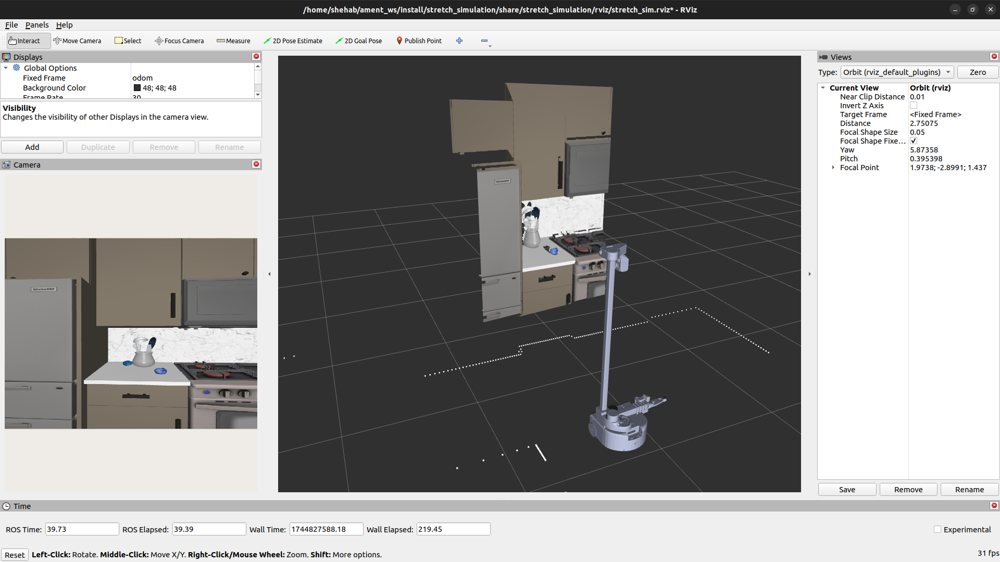

# Stretch Simulation in ROS2

Use this package to use ROS2 with Stretch in Mujoco.

## Getting Started

You need Ubuntu 24.04 with [ROS 2 Jazzy](https://docs.ros.org/en/jazzy/Installation/Ubuntu-Install-Debs.html) (`ros-jazzy-desktop`), and an Nvidia GPU is recommended. Minimum 16GB RAM, 32GB recommended.

> Note: This package is not supported on MacOS, due to the lack of GPU acceleration and OpenGL 1.5+ support in Docker.

```shell
source /opt/ros/jazzy/setup.bash
mkdir -p ~/ament_ws/src && cd ~/ament_ws/src
git clone https://github.com/hello-robot/stretch4_ros2
vcs import < stretch4_ros2/stretch_simulation/stretch_ros2_jazzy.repos

cd ~/ament_ws
sudo rosdep init; rosdep update  # skip if rosdep is already set up
rosdep install -iy --from-paths src --skip-keys "hesai_ros_driver python-pytorch-pip"
colcon build --symlink-install --packages-up-to stretch_simulation stretch_nav2
source install/setup.bash

ros2 launch stretch_simulation stretch_mujoco_driver.launch.py
```

The first launch clones [stretch4\_mujoco](https://github.com/hello-robot/stretch4_mujoco) to `~/repos/stretch4_mujoco` and installs it editable with pip, which takes a few minutes. Changes you make in that checkout take effect on the next launch. To use a checkout somewhere else, set `STRETCH4_MUJOCO_PATH` before the first launch, or run `pip install --user --break-system-packages -e <path>` yourself.

> Note: If you are on a Stretch robot, the workspace in `~/ament_ws` already has this package, so you only need the `ros2 launch` command.

### RoboCasa scenes (optional)

The `use_robocasa` launch argument and the pre-mapped kitchen scenes below need [RoboCasa](https://robocasa.ai/), which is not installed by default (its support for Python 3.12 is limited):

```shell
cd ~/repos/stretch4_mujoco
git submodule update --init --depth 1
pip install --user --break-system-packages -e ".[robocasa]" ./third_party/robosuite -e ./third_party/robocasa
python3 third_party/robosuite/robosuite/scripts/setup_macros.py
python3 third_party/robocasa/robocasa/scripts/setup_macros.py
python3 third_party/robocasa/robocasa/scripts/download_kitchen_assets.py
```

### MolmoSpaces scenes (optional)

Spawn Stretch into a house from a [MolmoSpaces](https://github.com/allenai/molmospaces) dataset:

```shell
ros2 launch stretch_simulation stretch_mujoco_driver.launch.py use_molmospaces:=true molmospaces_house_index:=3
```

The first launch with `use_molmospaces:=true` installs stretch4\_mujoco's `molmo` extra, which pulls in torch, so it takes a while. Each house's assets are downloaded into `~/.cache/molmospaces` the first time it is used.

* `molmospaces_dataset` (default `procthor-10k`), `molmospaces_split` (default `train`) and `molmospaces_house_index` (default `0`) pick the house.
* `scene_xml:=/path/to/scene.xml` loads a MolmoSpaces scene file instead.
* Stretch spawns at the centroid of the house's largest room. Odometry is in the house's coordinates, so `odom` starts at that point rather than at the origin.

### Docker

The [Dockerfile](Dockerfile) adds Mujoco and Nvidia EGL rendering on top of the image our GitHub Action builds and tests ([.github/docker/Dockerfile](../.github/docker/Dockerfile)), which contains the full Stretch workspace, including Stretch Web Teleop. You need [Docker](https://docs.docker.com/engine/install/ubuntu/) and the [Nvidia Container Toolkit](https://docs.nvidia.com/datacenter/cloud-native/container-toolkit/latest/install-guide.html).

```shell
cd stretch4_ros2/stretch_simulation
make build     # builds both images; the first build takes a while. Add MOLMOSPACES=1 to include MolmoSpaces
make test-gpu  # checks that the container can see the GPU and render with EGL
make run       # opens a shell in the container
```

`make run` mounts your host checkouts over the container's copies, so you can edit them on the host:

* This `stretch4_ros2` checkout is mounted at `~/ament_ws/src/stretch4_ros2`. The workspace is built with `--symlink-install`, so edits to existing Python and launch files apply right away. Run `colcon build --symlink-install` in the container after adding files or changing C++ code.
* `~/repos/stretch4_mujoco` is mounted at the same path in the container, if you have a checkout there (set `MUJOCO_SRC=<path>` to use another one). If you change its dependencies, re-run `pip install --user --break-system-packages -e ~/repos/stretch4_mujoco` in the container.

The base image builds the committed HEAD of this repo, so `make build` does not include uncommitted changes, but the mounts do. Use `make shell` to open more terminals in the running container.

## Launching

The main launch file is `stretch_mujoco_driver.launch.py` which you can invoke by running:

```shell
ros2 launch stretch_simulation stretch_mujoco_driver.launch.py
```

This launch file has many arguments that you can pass via the command-line.

### Driver Options

* `mode` (default=`position`, options: `position`, `navigation`, `trajectory`, `gamepad`) - command mode for the robot
* `use_cameras` (default=false) - Enabling the cameras uses a bit of CPU

### Scene Options

* By default, the Stretch spawns into a simple three-walled scene with objects on a table.
* By setting `use_robocasa` to True, you can spawn into a number of different [RoboCasa](https://robocasa.ai/) environments.
* You can also use your own custom scene by providing the absolute path to its XML to the `scene_xml` path. The Stretch 4 robot will be included at the origin if you have `<include file="stretch_4/stretch_4.xml"/>` in the scene xml.

### Visualization Options

* `use_mujoco_viewer` (default=true)
* `use_rviz` (default=true)

> Note: If using zenoh middleware, you should run `ros2 run rmw_zenoh_cpp rmw_zenohd` in its own terminal.

## Nav2

### Mapping

This section is similar to https://docs.hello-robot.com/0.3/ros2/navigation\_stack/#mapping, but uses the Stretch simulation environment.

To map the simulated environment, run the following:

```shell
# Terminal 1: Zenoh Router
ros2 run rmw_zenoh_cpp rmw_zenohd

# Terminal 2: Slam Toolbox
ros2 launch stretch_nav2 online_async_launch.py use_sim_time:=true
# Optional: Navigation bringup:
ros2 launch stretch_nav2 navigation_mppi.launch.py use_slam:=true use_sim_time:=true use_rviz:=true teleop_type:=none

# Terminal 3: Stretch Mujoco Driver
export MUJOCO_GL=egl # On Ubuntu, tell Mujoco to use the GPU
ros2 launch stretch_simulation stretch_mujoco_driver.launch.py use_mujoco_viewer:=true mode:=navigation use_robocasa:=false

# Terminal 4: Keyboard Teleop
ros2 service call /switch_to_navigation_mode std_srvs/srv/Trigger
ros2 run teleop_twist_keyboard teleop_twist_keyboard --ros-args --remap cmd_vel:=/stretch/cmd_vel
```

To save your map, run:

```sh
mkdir -p ~/stretch_maps
ros2 run nav2_map_server map_saver_cli -f ~/stretch_maps/<map_name>
```

### Navigation

To run navigation on a previously generated map, run:

```sh
# Terminal 1: Stretch Mujoco Driver
ros2 launch stretch_simulation stretch_mujoco_driver.launch.py use_mujoco_viewer:=true use_rviz:=false mode:=navigation

# Terminal 2: Navigation
ros2 service call /switch_to_navigation_mode std_srvs/srv/Trigger

ros2 launch stretch_nav2 navigation_mppi.launch.py map:=$HOME/stretch_maps/<map_name>.yaml use_sim_time:=true use_rviz:=true teleop_type:=none
```

You may want to dynamically reduce the cost\_map inflation radius for most Robocasa environments:

```shell
ros2 param get /global_costmap/global_costmap inflation_layer.inflation_radius
ros2 param get /local_costmap/local_costmap  inflation_layer.inflation_radius

ros2 param set /global_costmap/global_costmap inflation_layer.inflation_radius 0.20
ros2 param set /local_costmap/local_costmap  inflation_layer.inflation_radius 0.20
```

#### Pre-mapped scene

There are [maps](https://github.com/hello-robot/stretch4_ros2/blob/jazzy/stretch_simulation/maps/README.md) included in this package that you can use with navigation out of the box.

Launch the pre-mapped environment using the following commands:

```shell
# Terminal 1
ros2 launch stretch_simulation stretch_mujoco_driver.launch.py use_mujoco_viewer:=true mode:=navigation robocasa_layout:='G-shaped' robocasa_style:=Modern_1

# Terminal 2
ros2 launch stretch_nav2 navigation_mppi.launch.py map:=~/ament_ws/src/stretch4_ros2/stretch_simulation/maps/gshaped_modern1_robocasa.yaml use_sim_time:=true use_rviz:=true teleop_type:=none

# Terminal 3
ros2 service call /stow_the_robot std_srvs/srv/Trigger
ros2 param set /global_costmap/global_costmap inflation_layer.inflation_radius 0.20
ros2 param set /local_costmap/local_costmap  inflation_layer.inflation_radius 0.20
```

## Web Teleop

You can use Stretch Web Teleop with the Stretch Simulation environment!

This needs [stretch4\_web\_teleop](https://github.com/hello-robot/stretch4_web_teleop) in your workspace. The [Docker](#docker) image already has it.

Use the following commands to start Stretch Mujoco with Web Teleop:

```shell
parallel_terminal="gnome-terminal --tab -- /bin/bash -c " # or "xterm -e"

# Terminal 1
$parallel_terminal "MUJOCO_GL=egl ros2 launch stretch_simulation stretch_mujoco_driver.launch.py use_mujoco_viewer:=false mode:=position robocasa_layout:='G-shaped' robocasa_style:=Modern_1 use_rviz:=false use_cameras:=true map:=~/ament_ws/src/stretch4_ros2/stretch_simulation/maps/gshaped_modern1_robocasa.yaml" &

# Terminal 2
$parallel_terminal "ros2 launch stretch_simulation stretch_simulation_web_interface.launch.py" &

# Terminal 3
$parallel_terminal "cd ~/ament_ws/src/stretch4_web_teleop; npm run localstorage" &

# Terminal 4
$parallel_terminal "cd ~/ament_ws/src/stretch4_web_teleop; sudo node ./server.js" &

# Terminal 4
$parallel_terminal "cd ~/ament_ws/src/stretch4_web_teleop; node start_robot_browser.js" &
```

## Cameras and PointClouds

Please use the `use_cameras:=true` argument to enable cameras and pointclouds. e.g. `ros2 launch stretch_simulation stretch_mujoco_driver.launch.py use_mujoco_viewer:=true mode:=navigation use_cameras:=true`

There are five camera topics being published:

* RGB and Depth for the D405 camera in the gripper.
* RGB and Depth or the D435i camera in the head.
* RGB for the wide-lens camera in the head.

The RGB and Depth frames are used to create two PointCloud2 topics as well.



## Stretch Drivers

Simulation Drivers interface with the simulator to read and write data.

Simulation Drivers mimic the StretchDriver in `stretch_core`, which talks to the real robot.

You could display all the launch options available to the Stretch Mujoco Driver using: `ros2 launch stretch_simulation stretch_mujoco_driver.launch.py --show-args`:

```
    'broadcast_odom_tf':
        Whether to broadcast the odom TF. Valid choices are: ['True', 'False']
        (default: 'True')

    'fail_out_of_range_goal':
        Whether the motion action servers fail on out-of-range commands. Valid choices are: ['True', 'False']
        (default: 'False')

    'mode':
        The mode in which the ROS driver commands the robot. Valid choices are: ['position', 'navigation', 'trajectory', 'gamepad']
        (default: 'position')

    'use_rviz':
        One of: ['true', 'false']
        (default: 'true')

    'use_mujoco_viewer':
        One of: ['true', 'false']
        (default: 'true')

    'use_cameras':
        One of: ['true', 'false']
        (default: 'false')

    'use_robocasa':
        One of: ['true', 'false']
        (default: 'true')

    'robocasa_task':
        no description given
        (default: 'PnPCounterToCab')

    'robocasa_layout':
        One of: ['Random', 'One wall', 'One wall w/ island', 'L-shaped', 'L-shaped w/ island', 'Galley', 'U-shaped', 'U-shaped w/ island', 'G-shaped', 'G-shaped (large)', 'Wraparound']
        (default: 'Random')

    'robocasa_style':
        One of: ['Random', 'Industrial', 'Scandanavian', 'Coastal', 'Modern_1', 'Modern_2', 'Traditional_1', 'Traditional_2', 'Farmhouse', 'Rustic', 'Mediterranean', 'Transitional_1', 'Transitional_2']
        (default: 'Random')

```

You can also set the node's argument `arguments=["--ros-args", "--log-level", "debug"]` in the launch file to display Sim-to-Real time and other useful debug information.
